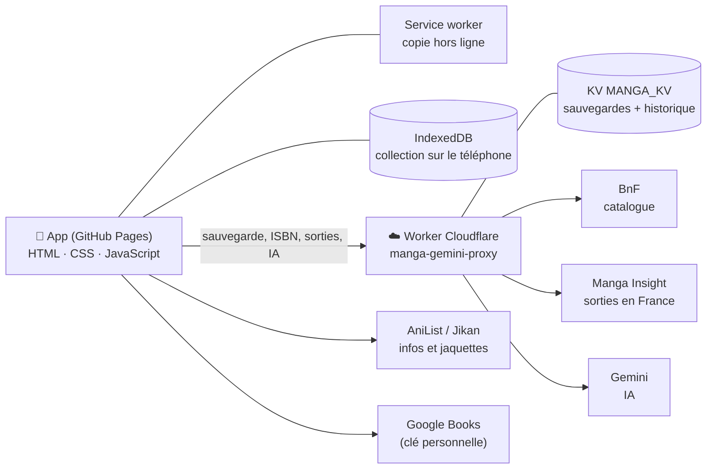

# Ma MangaThèque

Application web pour gérer sa collection de mangas : tomes possédés et lus, pile à lire, tomes à acheter, prochaines sorties. Elle s'installe sur l'écran d'accueil de l'iPhone comme une vraie app (PWA) et fonctionne même sans réseau.

**Adresse :** https://biloubils-lab.github.io/Book/

---

## Ce que fait l'app

| Écran | Rôle |
|---|---|
| **Pile à lire** | Tomes possédés mais pas encore lus, en trois sous-onglets : *En cours*, *Effort* (presque fini), *À commencer*. « Lu ✓ » en un geste, avec « Annuler ». |
| **Collection** | Toutes les séries, avec progression, tri et recherche. Un appui ouvre la **fiche** de la série. |
| **À venir** | *Prochaines sorties* estimées mois par mois, et *À acheter* : les tomes sortis qui manquent, à cocher en magasin. |
| **Quoi de neuf ?** | S'ouvre au lancement **seulement s'il y a du nouveau** : tomes sortis depuis la dernière visite, sorties attendues ce mois-ci. |
| **Fiche d'une série** | Tomes (lus, possédés, manquants), prochain à acheter, prochaine sortie. Menu ⋯ : édition / tomes / jaquette, renommer, infos, mettre de côté, supprimer. |
| **Notifications 🔔** | Sur l'iPhone, même app fermée : tome annoncé, nouveau tome en librairie. Calculées chaque jour par le dépôt privé `mangatheque-sauvegarde`, envoyées par Web Push. Un appui ouvre *À venir* (et la fiche s'il n'y a qu'une série). |
| **Paramètres ⚙️** | Mise à jour des séries, complétion des infos, jaquettes manquantes (d'après l'ISBN de l'édition), inventaire, recherche ISBN, sauvegarde en ligne, apparence (clair / sombre / automatique). |

Autres fonctions : ajout d'une série guidé (« ➕ Saisie » propose les éditions françaises avec éditeur, nombre de tomes et jaquette), scan du code-barres (ISBN) avec vérification de l'édition, **scan en rafale** (plusieurs tomes à la suite après un achat, puis un résumé à valider), **vérification en magasin** (scanner un livre pour savoir si on l'a déjà, sans rien modifier), inventaire série par série, import CSV / JSON, export.

---

## Comment c'est construit



- **L'app** est un site statique (aucun framework), publié par **GitHub Pages** depuis la branche `main`.
- **Les données** sont sur le téléphone (IndexedDB), et copiées en ligne à chaque modification. Chaque lundi, une copie de sécurité est aussi rangée dans le dépôt privé `mangatheque-sauvegarde` (avec l'historique de toutes les versions).
- **Le Worker Cloudflare** sert de relais : il garde les secrets (clé Gemini, code de sauvegarde), stocke les sauvegardes et interroge les services qui refusent les appels directs depuis un navigateur.
- **Le service worker** (`sw.js`) garde une copie de l'app et des jaquettes : l'app s'ouvre en mode avion.

### Les fichiers

```
index.html            Structure de la page (onglets, fenêtres)
css/style.css         Apparence. Les couleurs des thèmes sont en haut du fichier (variables --…)
js/                   Code de l'app, découpé par thème (chargé dans l'ordre de index.html, demarrage.js en dernier)
  outils.js             État de l'app, fenêtres de dialogue, appels réseau
  stockage.js           IndexedDB, sauvegarde en ligne, historique, Paramètres, thème
  vues.js               Onglets Pile à lire, Collection, À venir
  fiche.js              Fiche d'une série
  maj-serie.js          Édition, nombre de tomes et jaquette d'une série
  ajout-serie.js        Ajouter une série : éditions proposées pendant la saisie du titre
  mise-a-jour.js        Compléter la collection, BnF, Manga Insight (sorties, estimations)
  nouveautes.js         Page « Quoi de neuf ? »
  notifications.js      Activer / désactiver les notifications des sorties
  recherche-infos.js    Infos d'une série (AniList, Jikan, Google Books, Gemini)
  isbn-scanner.js       Recherche ISBN et scan du code-barres
  inventaire.js         Mode inventaire
  rafale.js             Scan en rafale (plusieurs tomes à la suite)
  magasin.js            Vérification en magasin (déjà possédé ? manquant ? autre édition ?)
  jaquettes.js          Jaquettes
  import-export.js      Import CSV, import / export JSON
  demarrage.js          Lancement, service worker, fermeture des fenêtres par le fond
sw.js                 Service worker (mode hors ligne, réception des notifications)
manifest.webmanifest  Manifeste de l'app (nécessaire aux notifications sur iPhone)
icones/               Icône de l'app (source : icone.svg)
polices/              Police des titres (Bangers, licence SIL OFL)
worker/               Worker Cloudflare (worker.js) et sa configuration de déploiement (wrangler.toml)
tests/                Tests automatiques (voir tests/README.md)
.github/              Tests et déploiement automatiques (GitHub Actions), Dependabot
```

### Le Worker (`worker/worker.js`)

| Route | Rôle |
|---|---|
| `GET/POST /backup` | Lire / enregistrer la sauvegarde (en-tête `X-Backup-Token`). Refuse un envoi qui viderait la sauvegarde, sauf `X-Backup-Force`. |
| `GET /backup/versions`, `GET /backup?version=…` | Historique : une version par jour d'utilisation, 30 au plus |
| `GET /isbn?isbn=…` | Livre d'après son ISBN (BnF) |
| `GET /edition?mots=…` | Tomes d'une édition à la BnF |
| `GET /mangainsight/core`, `/mangainsight/rows` | Données de sorties Manga Insight, relayées |
| `GET /infos?titre=…` | Infos d'une série par l'IA (Gemini) |
| `GET /modeles` | Modèles Gemini disponibles (diagnostic) |
| `GET /push/cle`, `POST /push/abonnement`, `POST /push/desabonnement` | Notifications : clé publique, abonner / désabonner un appareil (code de sauvegarde) |
| `GET /push/envoi` | Clés et appareils abonnés, pour l'envoi quotidien depuis le dépôt privé (code de sauvegarde) |

**Réglages gardés dans Cloudflare** (jamais dans le dépôt) :

| Nom | Type | Rôle |
|---|---|---|
| `BACKUP_TOKEN` | secret | Code de sauvegarde (le même que dans l'app) |
| `GEMINI_API_KEY` | secret | Clé de l'IA Gemini |
| `GEMINI_MODELES` | variable (facultative) | Liste des modèles Gemini à essayer |
| `MANGA_KV` | stockage KV | Sauvegardes et historique (identifiant dans `worker/wrangler.toml`) |

---

## Publier une modification

Le circuit est entièrement automatique :

```
modification → PR → tests (GitHub Actions) → fusion sur main → mise en ligne
```

1. **Pull request** : les tests (`Tests / tests`) et la construction à blanc du Worker (`Tests / worker`) tournent. Ne fusionner que si tout est ✅.
2. **Fusion sur `main`** :
   - l'**app** est republiée par GitHub Pages (1 à 2 minutes) ;
   - si `worker/` a changé, le **Worker** est redéployé par le workflow *Déploiement du Worker* (tests d'abord, puis Cloudflare). Relance manuelle possible : onglet **Actions → Déploiement du Worker → Run workflow**.

### ⚠️ À chaque nouvelle version de l'app

Changer le numéro **partout à la fois** (un test vérifie qu'ils sont identiques) :

- dans `index.html` : le `?v=…` de chaque fichier CSS / JS / icône, et le texte `v…` affiché en bas de l'écran ;
- dans `sw.js` : `const VERSION = '…'`.

Sans cela, le téléphone garderait l'ancienne copie de l'app.

### Secrets GitHub (Settings → Secrets and variables → Actions)

| Nom | Rôle |
|---|---|
| `CLOUDFLARE_API_TOKEN` | Jeton Cloudflare (modèle « Edit Cloudflare Workers ») pour déployer le Worker |
| `CLOUDFLARE_ACCOUNT_ID` | Identifiant du compte Cloudflare |

---

## Tests

Des tests de bout en bout (Playwright) ouvrent l'app dans un vrai navigateur, avec les services extérieurs simulés : pile à lire, collection, fiche, À venir, ISBN, scan, inventaire, éditions, sauvegarde, mode hors ligne, thèmes, Worker… Ils tournent à chaque PR. Pour les lancer soi-même : voir [`tests/README.md`](tests/README.md).

---

## Surveillance des sources

Chaque lundi, le workflow **Surveillance des sources** (`tests/surveillance.js`) interroge les vrais services — Manga Insight, BnF et Gemini à travers le Worker, AniList et Jikan en direct — et vérifie que leurs réponses ont toujours la forme attendue. En cas d'échec, GitHub envoie un e-mail ; le détail (quelle source, quelle fonction de l'app est touchée) est dans l'onglet **Actions**. Lancement à la main : **Actions → Surveillance des sources → Run workflow**.

## En cas de problème

| Symptôme | Que faire |
|---|---|
| L'app affiche une ancienne version | Vérifier que la PR est fusionnée et que *pages build and deployment* est vert (onglet Actions), puis fermer et rouvrir l'app. |
| « Code de sauvegarde incorrect » | ⚙️ → Réglages avancés → 🔑 Code de sauvegarde : coller le même code que `BACKUP_TOKEN`. Code perdu : en choisir un nouveau, le mettre dans Cloudflare **et** dans l'app. |
| Collection vide (nouveau téléphone, nouveau raccourci) | ⚙️ → 🔑 Code de sauvegarde → « Oui, j'ai un code » → l'app propose de récupérer la collection. |
| Une erreur a abîmé la collection | ⚙️ → 🕘 Restaurer une sauvegarde : choisir une version de l'historique (l'état actuel y est gardé). |
| Sauvegarde en ligne perdue (Cloudflare) | Dépôt privé `mangatheque-sauvegarde` : télécharger `bibliotheque.json` (ou une ancienne version via **History**), puis ⚙️ → Réglages avancés → 📤 Importer une sauvegarde. |
| Le déploiement du Worker échoue | L'ancien Worker continue de tourner. Lire l'erreur dans Actions ; vérifier les secrets GitHub, puis **Run workflow**. |
| Mauvais nombre de tomes / mauvaise jaquette | Fiche → ⋯ → 🔄 Édition, tomes et jaquette. |

---

## Sources de données et crédits

- **[Manga Insight](https://mangainsight.fr/)** — sorties en France (licence CC BY 4.0)
- **BnF** — catalogue général (SRU)
- **AniList**, **Jikan (MyAnimeList)** — infos et jaquettes des séries
- **Google Books**, **Open Library** — livres et jaquettes par ISBN
- **Gemini** — infos complémentaires par IA
- **ZXing** — lecture des codes-barres
- **Bangers** — police des titres (SIL Open Font License, voir `polices/LICENCE.txt`)
